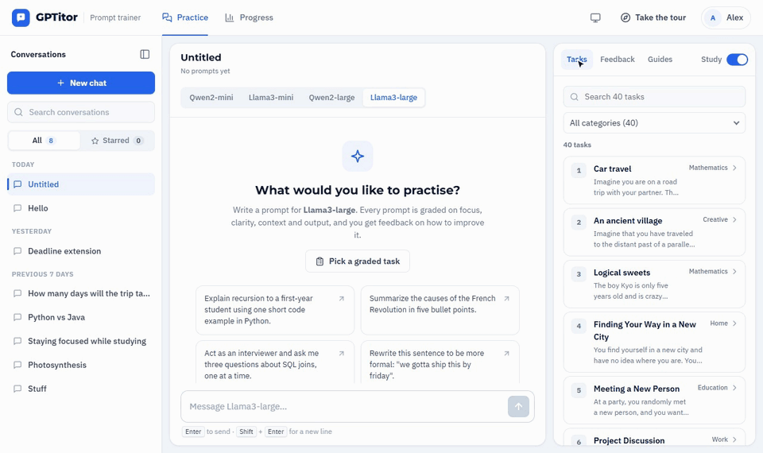
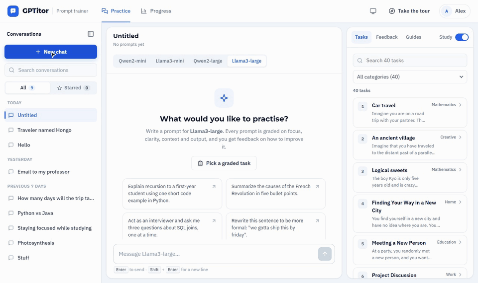
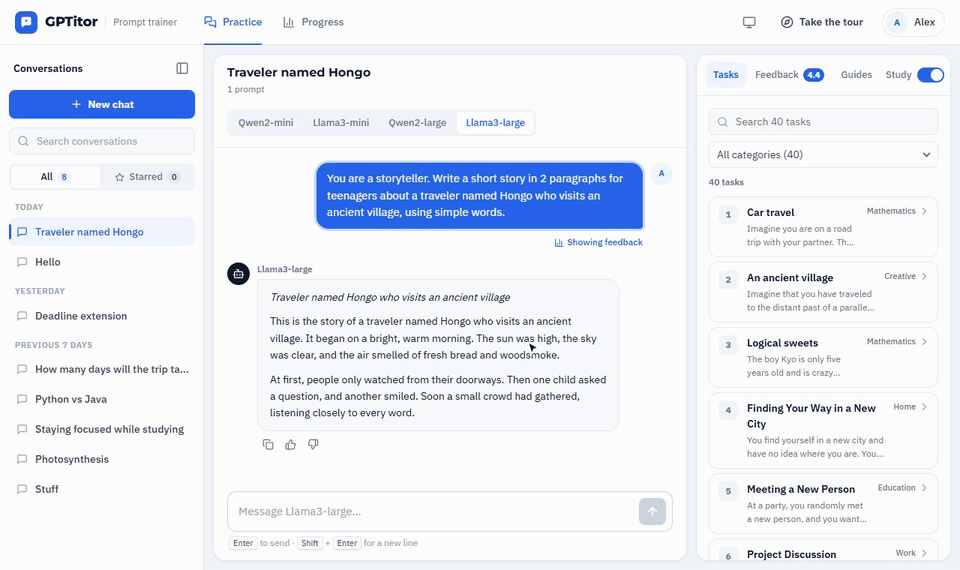
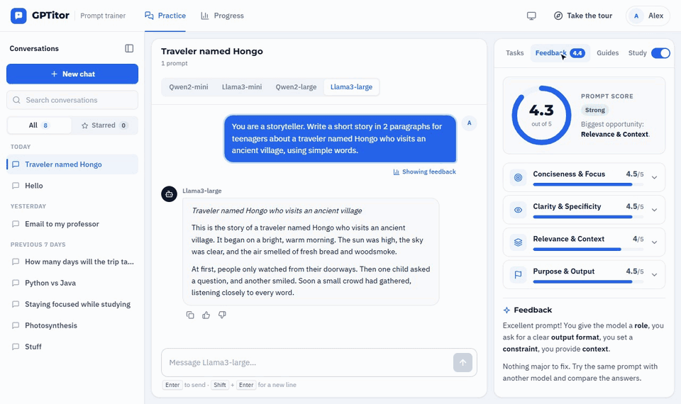
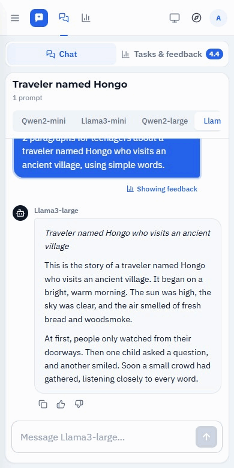

# GPTitor

**Learn to write better prompts by practising them.**
GPTitor is a prompt-writing sandbox: pick a task, write a prompt, and get an answer together with a score and concrete feedback on how to improve the prompt.

<p align="center">
  
</p>

## Features

### Practise with graded tasks
Browse 40 tasks across 10 categories (maths, creative writing, work, health, travel and more). Start a task, write a prompt for it, and the answer appears together with your score.

### Feedback on every prompt
Every prompt is scored out of 5 on four criteria. Each criterion shows what you did well or what to fix, and the written feedback ends with a suggested rewrite of your prompt.

| Criterion | What it checks |
|---|---|
| **Conciseness & Focus** | One clear request, at a sensible length |
| **Clarity & Specificity** | A clear action and concrete wording, no vague terms |
| **Relevance & Context** | Who the answer is for, why you need it, and the task's key facts |
| **Purpose & Output** | The expected format: a list, a table, a word limit… |

### Stop a prompt at any time
Press **Stop** or **Esc** while an answer is on its way. Your prompt comes back into the box so you can edit it, and nothing is saved.

<p align="center">
  
</p>

### Your conversation history
Conversations are grouped by date and titled automatically. You can search them, star the ones you want to keep, and rename them.

<p align="center">
  
</p>

### Track your progress
The **Progress** page shows how many prompts you've sent, your activity over the last 7 or 30 days, and your average score per criterion, plus which skill to focus on next.

<p align="center">
  
</p>

### Light and dark themes
Switch between light, dark or your system setting from the header.

<p align="center">
  
</p>

### Works on phones
On small screens the history opens as a drawer, and you switch between the chat and the tasks & feedback panel.

<p align="center">
  
</p>

There's also a guided tour (**Take the tour** in the header) and short guides on prompting techniques in the **Guides** tab.

## How the answers work

Answers and grades come from GPTitor's built-in answer engine ([`API/Utilities/answer_engine.py`](API/Utilities/answer_engine.py)), so no external AI service or API key is needed.

- **Answers** follow what the prompt asks for: a story, an email, a table, bullet points, a plan, a comparison or code.
- **Grading** reads the prompt itself. It checks for a role, context, an audience, an output format, constraints, vague wording and length, and for task prompts, whether the task's key facts are included.

A better prompt really does get a better score.

## Getting started

### Prerequisites
- **Node.js** 18 or newer
- **Python** 3.9 or newer

### 1. Clone the repository
```bash
git clone https://github.com/3llimi/GPTitorSWP.git
cd GPTitorSWP
```

### 2. Start the backend (FastAPI)
```bash
cd API
python -m venv .venv
# Windows:      .venv\Scripts\activate
# macOS/Linux:  source .venv/bin/activate
pip install fastapi==0.111.0 uvicorn==0.30.1 SQLAlchemy==2.0.31 SQLAlchemy-Utils==0.41.2 sqlalchemy-json==0.4.0 aiohttp==3.9.5 pydantic==2.7.4
uvicorn Core.main:app --reload
```
The API runs on http://127.0.0.1:8000, with interactive docs at http://127.0.0.1:8000/docs. The SQLite database (`gptitor.db`) is created and filled with tasks on first start.

> These are the packages the app needs to run. `requirements.txt` also lists development and testing tools. Some of them are large (`torch`, `transformers`), and `uvloop` doesn't install on Windows.

### 3. Start the frontend (React + Vite)
In a second terminal:
```bash
cd React
npm install
npm run dev
```
Open http://localhost:5173/gptitor/.

The frontend talks to the API address set in [`React/src/config.ts`](React/src/config.ts) (`http://127.0.0.1:8000` by default).

### Docker Compose (alternative)
With Docker installed, run this from the repository root:
```bash
docker-compose up --build
```
The backend is exposed on port 8000 and the frontend on port 5173. Stop it with `docker-compose down`.

## Running the tests
```bash
# Frontend (Jest + Testing Library)
cd React
npm test

# Backend (pytest), with the test tools installed
cd API
pip install pytest pytest-asyncio pytest-mock pytest-cov pytest-json httpx
pytest
```

## Project structure
```
API/                FastAPI backend
  Core/             app, database models, schemas, data access
  Routers/          REST endpoints (conversations, messages, feedback, tasks, profile…)
  Utilities/        answer engine, title generation, database seeding
  Data/             tasks and categories loaded on first start
React/              React + TypeScript frontend (Vite)
  src/              components, styles (design tokens in index.css), hooks
Media/features/     GIFs used in this README
```

## Technology
- **Frontend:** React 18, TypeScript, Vite, Chart.js, react-markdown (with KaTeX for maths), react-joyride
- **Backend:** FastAPI, SQLAlchemy, SQLite, Uvicorn
- **Testing:** Jest and Testing Library (frontend), pytest (backend)

## CI/CD (Innopolis University GitLab)

[`.gitlab-ci.yml`](.gitlab-ci.yml) defines the pipeline used on the Innopolis University GitLab:

- **Build:** builds the backend and frontend Docker images.
- **Lint:** ESLint for the frontend, Flake8 for the backend.
- **Test:** Jest and pytest.
- **Deploy:** deployment commands, to be adapted to your environment.

It's set up for the university's DevOps Playground. See the [CI/CD tutorial](https://gitlab.pg.innopolis.university/n.askarbekuly/demo_docker_ci_cd/-/blob/master/README.md) there for details.

## More documentation
- [API documentation](API/README.md): endpoints, data formats and the database structure
- [React components documentation](React/README.md)

## License
This project is licensed under the MIT License. See the [LICENSE](LICENSE) file for details.

## Contact
GPTitor was built by a student team at Innopolis University:

- **Alexandra Starikova-Nasibullina**: [a.nasibullina@innopolis.university](mailto:a.nasibullina@innopolis.university) · Telegram [@lexandrinnn_t](https://t.me/lexandrinnn_t)
- **Makar Dyachenko**: [m.dyachenko@innopolis.university](mailto:m.dyachenko@innopolis.university) · Telegram [@index099](https://t.me/index099)
- **Anas Hamrouni**: [a.hamrouni@innopolis.university](mailto:a.hamrouni@innopolis.university) · Telegram [@reachnasta](https://t.me/reachnasta)
- **Ahmed Baha Eddine Alimi**: [a.alimi@innopolis.university](mailto:a.alimi@innopolis.university) · Telegram [@Allimi3](https://t.me/Allimi3)
- **Ildar Rakiev**: [i.rakiev@innopolis.university](mailto:i.rakiev@innopolis.university) · Telegram [@mescudiway](https://t.me/mescudiway)
